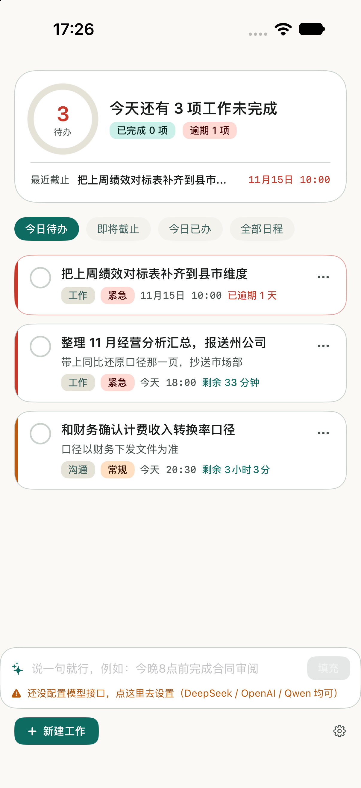
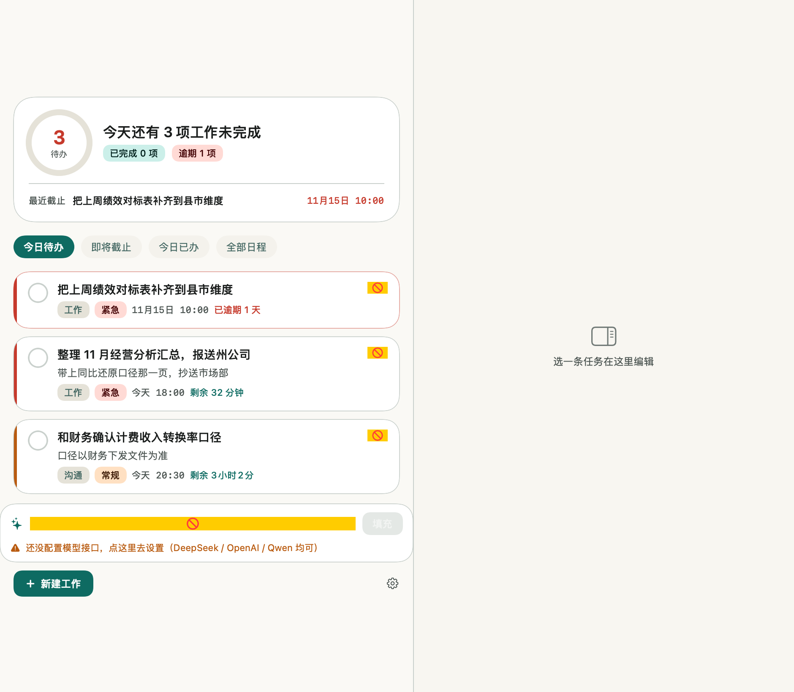
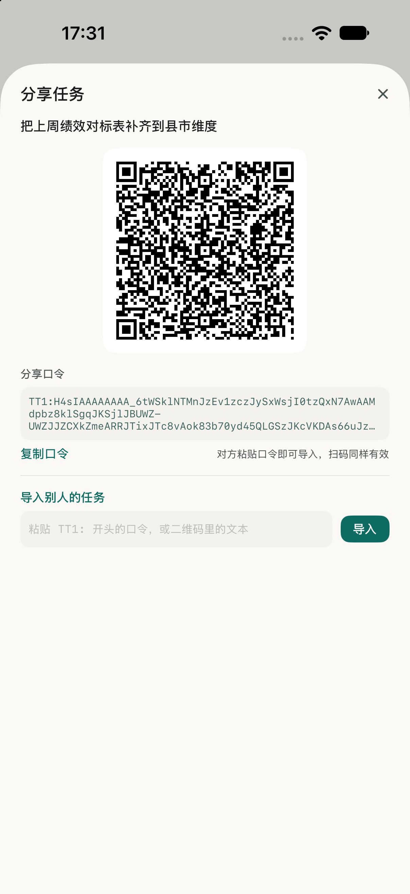
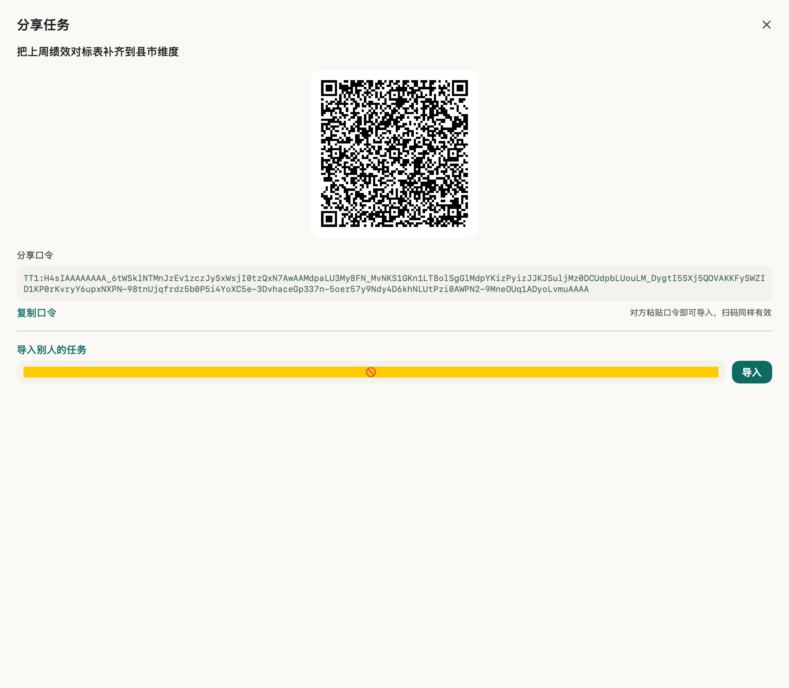

# 今日待办 · Swift 版（macOS + iPhone）

把 Android 版 `今日待办`（Kotlin + Jetpack Compose，AI Studio 导出）逐模块移植成**纯 Swift**：
不引 Firebase、不引跨平台框架，只用 Apple 系统框架（SwiftUI / Combine / CryptoKit / CommonCrypto / UserNotifications）。

原版在 [mjz1029/Daily-Task](https://github.com/mjz1029/Daily-Task)（Android），两端数据格式互通：任务 JSON 字段一致，`TT1:` 分享码与 `TD1:` 迁移口令可互相识别。

## 现在的状态

| 层 | 状态 | 验证方式 |
|---|---|---|
| 逻辑核心 + 界面状态层 | 完成 | `swift test` → 77 个测试通过（64 + 13） |
| macOS App | 完成并可运行 | `swift build` + 打包脚本，ImageRenderer 快照已核对 |
| iPhone App | 完成并可运行 | `xcodebuild` BUILD SUCCEEDED，iOS 27.2 模拟器（iPhone 18 Pro）截图已核对 |

| iPhone | macOS |
|---|---|
|  |  |
|  |  |

## 目录

```
TodayTasksSwift/
  Package.swift                 三个可测层 + SwiftUI 视图层（视图层需 Xcode 工具链）
  Sources/TodayTasksCore/       纯逻辑：模型、存储、AI 解析、分享码、换机协议
    TaskItem.swift              任务模型 / 优先级 / 今日归属判定
    DeadlineFormatter.swift     中文时间文案（今天/明天/剩余/逾期）
    LocalTasksStore.swift       JSON 整表存盘、原子写、排序、导入去重、变更监听
    Llm/                        LlmConfig、HTTP 传输抽象、自然语言解析器
    Sharing/                    Gzip（gzip 容器）、TT1: 单条分享码、QrCode（CoreImage 生成 + Vision 识别）
    Transfer/                   TransferBundle、TD1: 离线迁移口令、局域网应答状态机
  Sources/TodayTasksViewModel/  界面状态（只依赖 Combine，无 SwiftUI，可脱离 Xcode 测试）
    TasksViewModel.swift        四个筛选、计数、增删改、撤销删除、AI 草稿、设置
    AppSettings.swift           UserDefaults 偏好（模型配置、提醒开关）
    DemoSeeder.swift            环境变量门控的演示数据（仅截图验证用）
  App/SwiftUI/                  SwiftUI 视图（需要 Xcode 的 SwiftUIMacros）
    Theme.swift                 与 Android Color.kt 逐条对齐的浅色/深色调色板
    Views/TasksWorkspaceView.swift      主工作区（≥900pt 双栏，窄屏 sheet 编辑）
    Views/TodayFocusHeaderView.swift    进度环 + 计数 + 最近截止
    Views/TaskCardView.swift            任务卡片（优先级色条、逾期红框）
    Views/TaskEditorView.swift          编辑器（标题/备注/截止/优先级/分类/提醒）
    Views/QuickCaptureBar.swift         智能速记条 + 草稿确认
    Views/ShareTaskSheet.swift          分享面板（二维码 / 口令复制 / 粘贴导入）
    Views/SettingsView.swift            模型接口 + 数据管理
    ReminderScheduler.swift             UserNotifications 提醒（两端共用）
  App/MacApp/                   macOS 入口（窗口、AppDelegate、快照模式）
  App/iOS/                      iPhone/iPad 入口
  Tests/                        77 个 swift-testing 测试
  project.yml                   XcodeGen 工程描述（iOS + macOS 两个 App target）
  run_tests.sh                  跑测试
  bundle_mac.sh                 打 macOS .app（不依赖 Xcode 界面也能双击运行）
```

## 构建与运行

```bash
export DEVELOPER_DIR=/Applications/Xcode.app/Contents/Developer

# 1) 测试（72 个）
./run_tests.sh          # 或 swift test

# 2) macOS 版
./bundle_mac.sh         # 产物：build/今日待办.app，可双击运行

# 3) iPhone 版
xcodegen generate       # 生成 TodayTasks.xcodeproj
xcodebuild -project TodayTasks.xcodeproj -scheme TodayTasksIOS \
  -sdk iphonesimulator -destination 'platform=iOS Simulator,name=iPhone 18 Pro' build
xcrun simctl boot "iPhone 18 Pro"; xcrun simctl install booted <刚才构建出的 .app>
xcrun simctl launch booted com.mojizhou.todaytasks
```

截图核对用的环境变量（正式运行不设即空操作）：

```bash
# 写入几条演示任务（走 App 自己的 LocalTasksStore API）
TODAYTASKS_DEMO=1 TODAYTASKS_DATA_FILE=/tmp/demo/tasks.json \
  ./build/今日待办.app/Contents/MacOS/TodayTasksMac
# macOS 无窗口渲染成 PNG（screencapture 需要屏幕录制权限，ImageRenderer 不需要）
TODAYTASKS_DEMO=1 TODAYTASKS_SNAPSHOT=/tmp/shot.png \
  ./build/今日待办.app/Contents/MacOS/TodayTasksMac
# iOS 模拟器传环境变量用 SIMCTL_CHILD_ 前缀
SIMCTL_CHILD_TODAYTASKS_DEMO=1 xcrun simctl launch booted com.mojizhou.todaytasks
```

## 已移植（有测试背书）

| 模块 | 对应 Android | 测试数 |
|---|---|---|
| 任务模型 + 时间判定 | `model/TaskItem.kt` | 7 |
| 中文时间文案 | `util/DeadlineFormatter.kt` | 5 |
| 本地任务库（落盘/清洗/排序/导入去重/监听） | `data/LocalTasksStore.kt` | 12 |
| 自然语言建任务（提示词、400 重试、JSON 容错、字段清洗） | `ai/NaturalLanguageTaskParser.kt` | 11 |
| gzip + TT1 分享码 | `transfer/SingleTaskShareCodec.kt` | 8 |
| 换机转移（配对码/离线口令/局域网协议/限流） | `transfer/DevicePairingTransfer.kt` | 15 |
| 二维码生成与识别 | `transfer/QrCodeHelper.kt` | 5 |
| 界面状态（筛选口径、计数、撤销删除、AI 草稿接线） | `viewmodel/TaskViewModel.kt` | 13 |

```
$ swift test
✔ Test run with 13 tests in 1 suite passed after 0.041 seconds.
✔ Test run with 64 tests in 8 suites passed after 0.389 seconds.
```

## 与 Android 版的刻意偏差

Android 版有几个已确认的缺陷，移植时**没有照抄**（其余行为、文案、字段规则逐条对齐）：

1. **删除可撤销**：Android 删了不可恢复；这里保留内存快照，toast 上给「撤销」。
2. **提醒不留幽灵**：Android 的 `syncReminders` 只遍历现存任务，被删任务的闹钟永不 cancel；这里每次清空待发送通知后重排。
3. **AI 失败一定可见**：Android 只在三种布局挂了错误提示，上下分栏/左右双栏下点「填充」无反馈；这里错误固定显示在速记条下方。
4. **多条草稿不丢**：Android 在非批量路径只用 `drafts.first()`，第二条静默丢弃；这里多条一律走确认列表，单条才直接建。
5. **清空数据有入口**：Android 的 `clearAll()` 无调用方、设置页也无入口；这里设置页有「清空本机全部任务」并二次确认。
6. **提醒按操作触发授权**：不在冷启动时弹系统授权框（Android 也是用户动作时才请求通知权限）。

保持一致的语义（含看似反直觉的部分）：无截止时间的任务（`deadlineMillis == 0`）算进「今日待办」并排最前；「即将截止」筛选**不含**这类任务——两条都与 Android 原实现相同。

## 待移植

- 桌面小组件（WidgetKit，iOS 主屏 + macOS 桌面；Android 是 Glance，需加 App Group）
- 相机实时扫码（AVFoundation 采集 + Vision；模拟器无摄像头，需真机验证；生成与识别逻辑已完成并测试）
- 系统日历落库（EventKit，对应 Android 的 `ACTION_INSERT`）
- 换机转移的网络壳（TCP HTTP 监听 + NWBrowser/Bonjour；协议与密码学已在核心库完成并测试）
- iPad/折叠屏分栏细化（当前是 ≥900pt 双栏 + 窄屏 sheet）
- App 图标、启动页、文案本地化
- API Key 改存 Keychain（现在与 Android 一样是明文本地偏好）

## 约定

- 数据格式与 Android 版**双向兼容**：任务 JSON 字段名一致、缺字段解码走默认值；`TT1:` 分享码与 `TD1:` 迁移口令的 gzip/base64URL/AES-GCM/PBKDF2 参数与 Kotlin 实现同构——gzip 已用系统 `/usr/bin/gzip` 双向交叉验证，PBKDF2 已用 Python hashlib 标准向量核对。
- 核心与状态层不 import SwiftUI，保证 `swift test` 在只有 Command Line Tools 的机器上也能跑；SwiftUI 视图层必须有 Xcode（缺 `SwiftUIMacros` 插件时 `@State` 无法展开）。
- 字段清洗规则与 Android 一致：标题 120 / 备注 500 / 分类 20 / 提醒 0…1440。

## 许可

[MIT License](LICENSE) © 2026 Mao Jizhou

